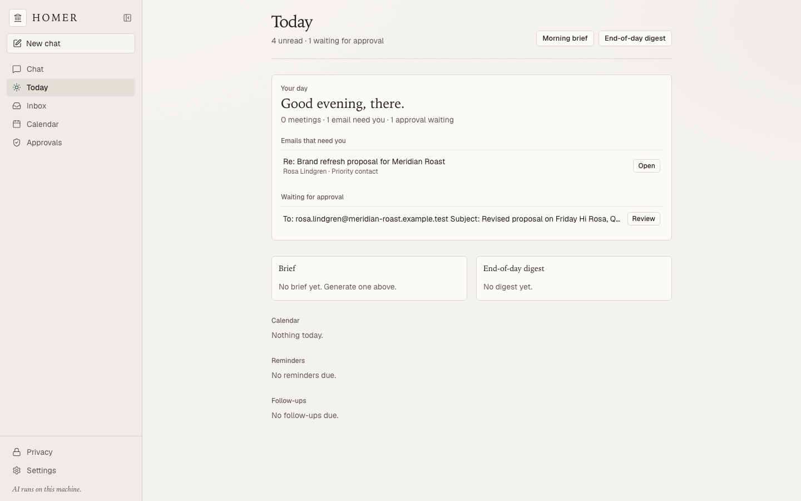
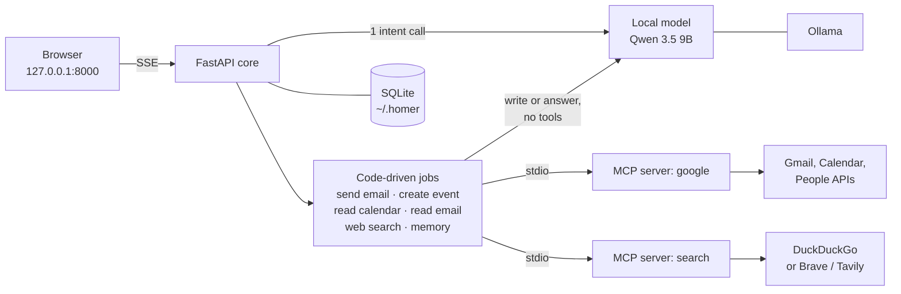

<p align="center">
  
</p>

<p align="center">
  <b>A private AI assistant for Gmail and Google Calendar. The model runs on your own machine, and nothing goes out until you press Send.</b>
</p>

<p align="center">
  <a href="https://github.com/Syed-Hamza10/homer/actions/workflows/ci.yml"></a>
  <a href="LICENSE"></a>
  
</p>

<p align="center">
  <picture>
    <source media="(prefers-color-scheme: dark)" srcset="docs/readme/chat-dark.png">
    
  </picture>
</p>

## Why Homer

- **The AI runs on your computer.** A local model (Qwen 3.5 9B through Ollama) reads your mail and writes your drafts. Your emails are never sent to an AI company, and there is no per-token bill.
- **Nothing happens without you.** Sending mail or changing your calendar always becomes an editable card. The backend enforces this, not the prompt: the model has no way to send.
- **You can check what it talked to.** Every outbound request goes through one allowlisted HTTP client and is logged. The Privacy page shows every host, with call counts.
- **Honest about the rest.** Google still sees your Google traffic, because that is where your mail lives. When web search is on, the search engine sees your query. Nothing else is contacted.

## See it in 60 seconds

**You need:** macOS on Apple Silicon with 16 GB RAM, or Linux with an 8 GB NVIDIA GPU; about 30 GB free disk; a Google account with [your own OAuth client](docs/GOOGLE_SETUP.md).

<!-- TODO: keep this line in sync with the installer's public one-liner in CLIENT_ONBOARDING.md -->
```sh
bash <(curl -fsSL https://github.com/Syed-Hamza10/homer/releases/latest/download/install.sh)
```

What happens next:

1. The installer checks RAM and disk, installs pinned `uv` and Ollama, verifies every wheel against `SHA256SUMS`, pulls the models (about 10 GB), asks for a passphrase and registers a launchd or systemd user service.
2. Save your OAuth client as `~/.homer/credentials/client_secret.json` and run `~/.homer/venv/bin/homer setup google`.
3. Open **http://127.0.0.1:8000**, sign in with your passphrase and ask *"What's on my calendar tomorrow?"*. The first answer takes about 10 s longer while the model loads.

The full procedure, operations and troubleshooting are in [CLIENT_ONBOARDING.md](CLIENT_ONBOARDING.md).

## What it does

| You ask | Homer |
| --- | --- |
| *"Reply to Rosa about the revised proposal, tell her I'll get it to her by Wednesday"* | Finds Rosa in your contacts or recent senders, finds the thread, writes the draft in your tone and shows an approval card. Edit it in the card or by asking ("make it shorter"), then press **Send**. Discard deletes the Gmail draft. |
| *"What's my day look like?"* / *"Move the Tuesday call to 3pm"* | Lists your calendar in your timezone. New, moved or cancelled events become an event card; nothing changes until you confirm. |
| *"Any news on coffee prices today?"* | Searches the web, reads the top two pages, answers in a few sentences and lists the sources. The query goes to DuckDuckGo (or Brave or Tavily if you add a key), never to an AI company. |
| *"Remember that Rosa prefers short emails"* | Saves the fact in a local SQLite table. *"What do you remember about Rosa?"* recalls it; *"forget that"* removes it. |

Around the chat there is a **Today** page (meetings, emails that need you, follow-ups, waiting approvals), a light **Inbox** and **Calendar**, an **Approvals** list, **Privacy** and **Settings**.

<p align="center">
  
  
</p>

## How it works



Small local models are reliable at filling in fields and unreliable at planning several tool calls. So Homer splits the work:

- **The model understands.** One structured call turns your message into typed intents (`send_email`, `create_event`, `read_calendar`, `read_email`, `web_search`, `remember`, `chat`, ...), validated by Pydantic. It gets a table of dates and copies them; it never does date arithmetic.
- **Code acts.** Each intent runs as a plain Python job with fixed calls to the MCP servers. The model is called at most once more, to write a draft or phrase an answer, and that call has no tools. Calendar listings need no model call at all.
- **Untrusted text is data.** Email bodies and web pages only reach model calls that cannot act. A prompt injection can at worst change a summary, not send mail.

**The approval flow, in three lines:**

1. A job that would send mail or change the calendar stores an approval: the exact payload, its SHA-256 hash and a preview. Nothing is sent.
2. You press Send. One conditional `UPDATE` moves it from `pending` to `running`, so a double click cannot send twice. An edit creates a new approval with a new hash.
3. The server re-checks the hash and runs the payload through an `execute` tool the model never sees. A timeout is marked `unknown` and never retried. Unanswered approvals expire after 24 hours.

More detail: [docs/ARCHITECTURE.md](docs/ARCHITECTURE.md) and the step-by-step [explainers](docs/EXPLAINERS/).

## Privacy, honestly

| Host | Why | When |
| --- | --- | --- |
| `127.0.0.1:11434` | Ollama, the local model | Always |
| `www.googleapis.com`, `oauth2.googleapis.com` | Your Gmail, Calendar and contacts, through your own OAuth project | When Google is connected |
| `html.duckduckgo.com` | Web search | Only when web search is on |
| `api.search.brave.com` or `api.tavily.com` | Optional search API | Only if you add a key |
| A page Homer reads for an answer | One host per call, re-checked on every redirect | Only when web search is on |

- **The allowlist is in code.** All outbound HTTP goes through one client in the `homer_net` package. A lint rule bans every other HTTP library, a host that is not on the list is refused before a connection opens, and a test proves it. Private network addresses are refused for page fetches.
- **Every call is logged.** One row per request (host, path, status, duration) in a local `outbound_log` table, which the Privacy page reads. You can query it yourself with `sqlite3`.
- **What others see.** Google sees your Google API traffic, as with any Gmail client. The search engine sees your search question, never your emails. Web search can be switched off on the Privacy page.
- **What it is not.** This is application-level enforcement, not a network sandbox. [PRIVACY.md](PRIVACY.md) is generated from the same host list the code uses.

Everything else (conversations, mail and calendar cache, approvals, memory, the log) stays in `~/.homer`.

## Status

Homer is an early beta. We test it in rounds of scripted conversations against the live model. Round 4 results:

| Area | Pass rate | Works well | Still rough |
| --- | --- | --- | --- |
| Calendar | 87% | Reading the day; creating, moving and cancelling with a card | Part-day windows ("Tuesday afternoon") |
| Email | 60% | Drafting and sending through the card, edits from chat | Follow-ups on a pending draft ("where's the link in it") |
| Conversation | 60% | Short answers, saving and recalling facts | Correcting or forgetting a saved fact |
| Search | 53% | Answers with source links | Dates in news answers |

Overall that is 65%, up from 57% in round 3. Our own bar is 9 out of 10 in each area, two rounds in a row; no area meets it yet. Other limits:

- **Speed is your machine's speed.** On an M3 Pro (18 GB) the median time from message to a ready draft is 4.4 s, but some replies still take more than 20 s.
- **A 9B model is not a frontier model.** Long reasoning and ambiguous requests fail more often, which is why every action ends with your decision.
- **Plain Gmail accounts reconnect weekly.** An OAuth app in Google's Testing mode loses its token after 7 days; Homer warns from day 5. Workspace teams with an Internal app do not have this limit.
- **macOS and Linux only**, English only.

## Development

A Python 3.12 `uv` workspace with six packages (`core`, `net`, `mcp_google`, `mcp_search`, `mcp_system`, `eval`) and a Vite + React dashboard served as a static build.

```sh
git clone https://github.com/Syed-Hamza10/homer.git && cd homer
uv sync --all-packages
mkdir -p ~/.homer && printf 'HOMER_PASSPHRASE=change-me\n' > ~/.homer/.env

make build        # dashboard static build
make dev          # API on 127.0.0.1:8000 with reload; `make dashboard-dev` for the Vite server
make test         # 729 fast tests: no model, no network
make test-e2e     # real server, MCP servers, simulator, live model and a browser
make lint         # ruff check and format
make eval-smoke   # task evals against the simulator, 3 runs each
```

- **The simulator.** `homer-sim` serves the Gmail, Calendar and People endpoints Homer uses, over fictional data. It is the fixture for every Google test, the evals and the demo, so no real mailbox is touched.
- **Fast tests** use Pydantic AI's `TestModel` and the simulator. CI runs them on Ubuntu and macOS.
- **End-to-end tests** (233 more) start the real stack with the live `qwen3.5:9b` model and Playwright. They skip themselves when Ollama is not running.
- `make preview` runs the dashboard on an empty install without Ollama, for UI work.

Design decisions and every deviation from the original plan are logged in [docs/DECISIONS.md](docs/DECISIONS.md). The [project guide](docs/PROJECT_GUIDE.md) walks through the codebase.

## Roadmap

- **Answers from your documents:** reply to a customer from a folder of your PDFs and text files, showing the passages used.
- **Voice** in and out, locally.
- **One-click Google sign-in** instead of creating your own OAuth client.
- **Windows** install and CI.

## Contributing

Issues are welcome. Bug reports, install problems on your hardware and transcripts where Homer got something wrong help most; please use made-up names and addresses in anything you post. For a larger change, open an issue first so we can agree on the approach.

## License

Homer is source-available under the [PolyForm Noncommercial License 1.0.0](LICENSE). You may use, study and modify it for personal, research and other noncommercial purposes. Commercial use needs permission from the authors; open an issue to get in touch.

## Credits

Built by Hamza (backend, integrations, dashboard) and Hassan (model choice, evals). Homer runs [Qwen 3.5](https://ollama.com/library/qwen3.5) through [Ollama](https://ollama.com) and is built with [Pydantic AI](https://ai.pydantic.dev), [FastAPI](https://fastapi.tiangolo.com) and the [Model Context Protocol](https://modelcontextprotocol.io).
