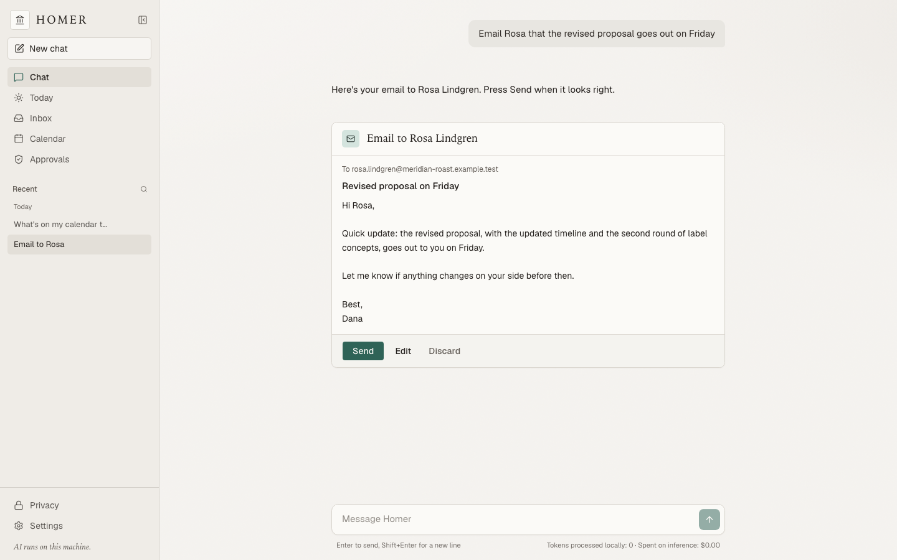
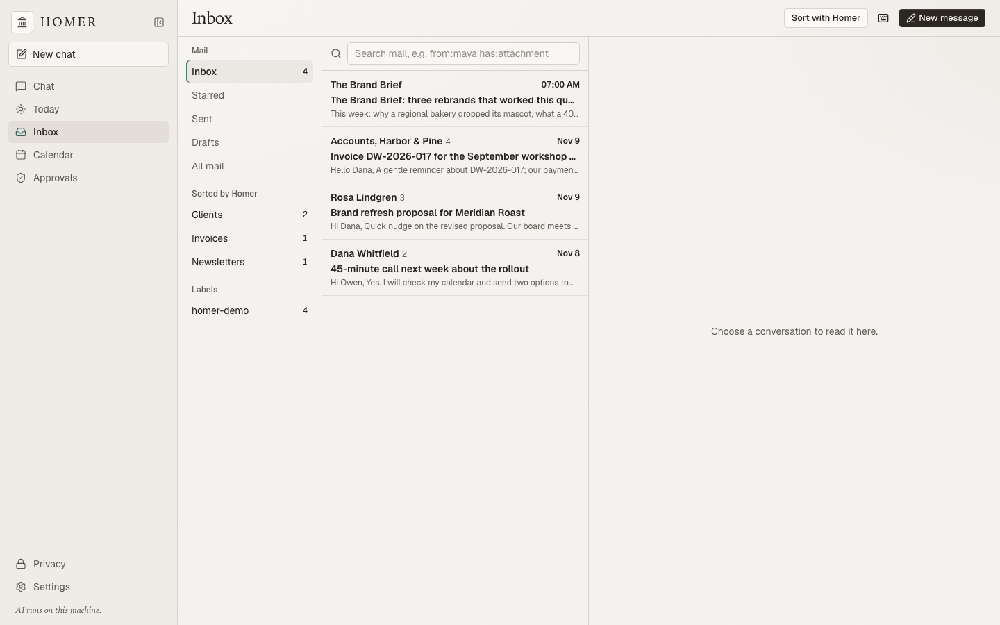

<p align="center">
  
</p>

<p align="center">
  <b>Your AI assistant, right at home. It runs on your own computer, works across your email, calendar and the web, and nothing goes out until you press Send.</b>
</p>

<p align="center">
  <a href="https://github.com/Syed-Hamza10/homer/actions/workflows/ci.yml"></a>
  <a href="LICENSE"></a>
  
</p>

<p align="center">
  <picture>
    <source media="(prefers-color-scheme: dark)" srcset="docs/readme/chat-dark.png">
    
  </picture>
</p>

## Why Homer

- **The AI runs on your computer.** A local model (Qwen 3.5 9B through Ollama) reads your mail and writes your drafts. Your emails are never sent to an AI company, and there is no per-token bill.
- **Nothing happens without you.** Sending mail or changing your calendar always becomes an editable card. The backend enforces this, not the prompt: the model has no way to send.
- **You can check what it talked to.** Every outbound request goes through one allowlisted HTTP client and is logged. The Privacy page shows every host, with call counts.
- **Honest about the rest.** Google still sees your Google traffic, because that is where your mail lives. When web search is on, the search engine sees your query. Nothing else is contacted.

## Try it

One line, on a Mac with Apple Silicon (16 GB or more) or a Linux machine with an NVIDIA GPU (8 GB or more). You need about 30 GB of free disk.

```sh
/bin/bash -c "$(curl -fsSL https://github.com/Syed-Hamza10/homer/releases/latest/download/install.sh)"
```

The installer sets everything up: Ollama, Homer, and the model (a 6 GB download, the slow part). It asks you for a passphrase, starts Homer in the background, and opens **http://127.0.0.1:8000**.

Then, in Homer:

1. **Settings → Google → Connect.** Sign in with the Google account you want Homer to use. For now this needs your own Google OAuth client, about 15 minutes in Google Cloud following [GOOGLE_SETUP.md](docs/GOOGLE_SETUP.md); one-click sign-in is on the roadmap.
2. Ask something: *"What's on my calendar tomorrow?"* The first answer takes about 10 seconds longer while the model loads.

Updating later is `homer update`. Everything else, including uninstalling and troubleshooting, is in [CLIENT_ONBOARDING.md](CLIENT_ONBOARDING.md).

## What it does

| You ask | Homer |
| --- | --- |
| *"Reply to Rosa about the revised proposal, tell her I'll get it to her by Wednesday"* | Finds Rosa in your contacts or recent senders, finds the thread, writes the draft in your tone and shows an approval card. Edit it in the card or by asking ("make it shorter"), then press **Send**. Discard deletes the Gmail draft. |
| *"What's my day look like?"* / *"Move the Tuesday call to 3pm"* | Lists your calendar in your timezone. New, moved or cancelled events become an event card; nothing changes until you confirm. |
| *"Any news on coffee prices today?"* | Searches the web, reads the top two pages, answers in a few sentences and lists the sources. The query goes to DuckDuckGo (or Brave or Tavily if you add a key), never to an AI company. |
| *"Remember that Rosa prefers short emails"* | Saves the fact in a local SQLite table. *"What do you remember about Rosa?"* recalls it; *"forget that"* removes it. |

Around the chat there is a **Today** page (meetings, emails that need you, follow-ups, waiting approvals), a light **Inbox** and **Calendar**, an **Approvals** list, **Privacy** and **Settings**.

<p align="center">
  
  
</p>

## Privacy, honestly

| Host | Why | When |
| --- | --- | --- |
| `127.0.0.1:11434` | Ollama, the local model | Always |
| `www.googleapis.com`, `oauth2.googleapis.com`, `people.googleapis.com` | Your Gmail, Calendar and contacts, through your own OAuth project | When Google is connected |
| `html.duckduckgo.com` | Web search | Only when web search is on |
| `api.search.brave.com` or `api.tavily.com` | Optional search API | Only if you add a key |
| A page Homer reads for an answer | One host per call, re-checked on every redirect | Only when web search is on |

- **The allowlist is in code.** All outbound HTTP goes through one client in the `homer_net` package. A lint rule bans every other HTTP library, a host that is not on the list is refused before a connection opens, and a test proves it. Private network addresses are refused for page fetches.
- **Every call is logged.** One row per request (host, path, status, duration) in a local `outbound_log` table, which the Privacy page reads. You can query it yourself with `sqlite3`.
- **What others see.** Google sees your Google API traffic, as with any Gmail client. The search engine sees your search question, never your emails. Web search can be switched off on the Privacy page.
- **What it is not.** This is application-level enforcement, not a network sandbox. [PRIVACY.md](PRIVACY.md) is generated from the same host list the code uses.

Everything else (conversations, mail and calendar cache, approvals, memory, the log) stays in `~/.homer`.

## Contributing

Issues are welcome. Bug reports, install problems on your hardware and transcripts where Homer got something wrong help most; please use made-up names and addresses in anything you post. For a larger change, open an issue first so we can agree on the approach.

## License

Homer is source-available under the [PolyForm Noncommercial License 1.0.0](LICENSE). You may use, study and modify it for personal, research and other noncommercial purposes. Commercial use needs permission from the authors.
