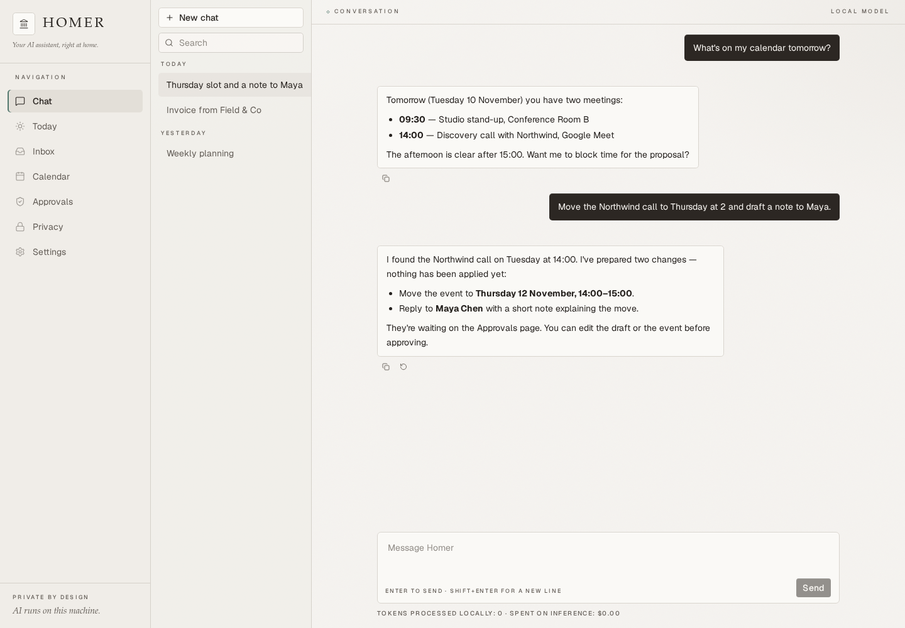
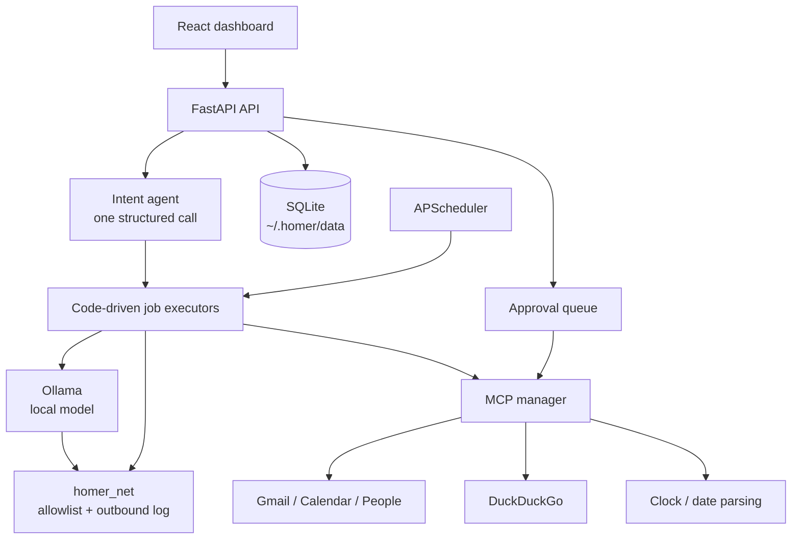

# Homer

> Maintainer and project reference. The public README is the short entry point.

**Your AI assistant, right at home.**

Homer is a local-first AI assistant, currently supporting Google Workspace. It runs on the user's
own computer: a FastAPI backend runs a local Ollama model, the mail and calendar work happens
through MCP tool servers, and application data stays in SQLite under `~/.homer`. There is no
hosted-model API key, no per-token bill, and no mailbox content sent to a third-party AI service.

Every outbound HTTP request passes through one allowlisted client and is recorded in a local
outbound log. Anything another person would see — sending mail, creating, moving or cancelling an
event — is prepared first and executed only after the user approves it.

<p align="center">
  
</p>

## Why Homer

- **Private by architecture, not by policy.** The language model runs through Ollama on
  `127.0.0.1`. Email and calendar data stay in a local SQLite database. The Privacy page reads a
  log of every outbound call the application made.
- **Human approval for consequential actions.** Sending mail, moving an event and every other
  third-party-visible action becomes an approval request with a canonical payload and SHA-256 hash.
  Drafts and events can be edited before approval; the old request is superseded and a fresh one is
  created. Double clicks cannot execute twice.
- **One controlled network path.** Every runtime request goes through `homer_net`, which refuses
  hosts outside its allowlist before opening a connection, re-checks every redirect hop, and writes
  a row to `outbound_log`. A lint rule blocks every other HTTP library.
- **Built for a small local model.** Homer does not ask a 9B model to plan a tool loop. One
  structured call extracts typed intents; code-driven jobs do the mail, calendar, search and
  memory work. The model writes text only where language matters.
- **A real mail and calendar surface.** A three-pane Gmail view and a Day/Week/Month calendar sit
  beside the assistant, with keyboard shortcuts, sanitised HTML mail and edit-before-send drafts.
- **Operable on a real machine.** A pinned installer, launchd/systemd service, nightly backups,
  atomic updates with rollback, a doctor command, and an end-to-end test suite.

## Features

| Area | What it does |
| --- | --- |
| **Chat** | Streaming markdown answers with tool activity, source chips, copy and timestamps, stop, regenerate, suggested prompts, and a conversation sidebar with search, rename and delete. |
| **Today** | A "Your day" card with meetings, emails that need you, follow-ups and waiting approvals, plus morning brief, end-of-day digest, reminders and system health. |
| **Inbox** | A live three-pane Gmail view: folders, labels and Homer categories, Gmail search, paging, threads, sanitised HTML in a sandboxed frame, blocked remote images, attachments, reply/reply-all/forward, new mail, "Draft with Homer", and send through an approval. |
| **Calendar** | A live Day/Week/Month calendar in the user's timezone with all-day events, overlaps, a now line, event details and a "Find a time" panel. Create by clicking or dragging, move by dragging, edit or cancel — all through approvals. |
| **Approvals** | Editable email and event cards, payload hashing, single-use decisions, 24-hour expiry, superseded edits and protection against double execution. |
| **Memory** | "Remember that…" and "forget that" facts, stored locally and included in later intent calls and replies. |
| **Search** | DuckDuckGo web search and allowlisted page fetching, with source links on the answer. |
| **Privacy** | Allowlisted-host report from `outbound_log`, web-search switch, token usage, `$0.00` inference spend and a confirmed local-data wipe. |
| **Settings** | Signature, tone, business hours, follow-up delay, priority contacts, timezone, model tier with a live smoke test, and a Google account card with reconnect. |
| **Automation** | Scheduled mail and calendar polling, reminder checks, briefs, digests, health checks, model warm-up and nightly backups. |
| **Operations** | `homer doctor`, `backup`, `update`, `rollback`, `logs`, `model use`, `setup google`, `privacy`, `forget`. |

## How it works



**Intent, then code.** Homer does not give the model a tool list. One structured call turns the
message, recent history and a date table into typed intents: send email, create event, read
calendar, read email, web search, remind or chat. Each intent runs through a code-driven executor
in `services/jobs/`, which calls the MCP servers, creates approvals and emits fixed confirmations.
The model is used again only to write an email body or phrase an answer. A claim guard prevents an
answer from saying something was sent or scheduled when it was only proposed.

**Tool servers.** Gmail, Calendar and People are exposed through a Google MCP server over stdio.
Web search and page fetching run in a search MCP server; clock and date parsing run in a system MCP
server. The core manages the servers and filters their internal tools. The model never sees an MCP
tool at all.

**Backend.** Python 3.12, FastAPI, Pydantic AI, SQLModel/SQLite and APScheduler. Routers are thin,
business logic lives in services, and database models hold no logic. Dependencies arrive through
FastAPI `Depends` from application state.

**Dashboard.** React 19, TypeScript, Vite, Tailwind CSS and shadcn/ui. It builds to static files
served by FastAPI, so an installed application needs no Node.js at runtime. `site/` contains a
standalone static landing page with a waitlist form.

**Model.** The supported tier is `qwen3.5:9b` through Ollama's OpenAI-compatible API with thinking
disabled; a smaller `qwen3.5:4b-q8_0` tier is available for lower-memory machines. Model tags live
only in `models/manifest.json`.

## Requirements

- macOS on Apple Silicon with **16 GB RAM or more** (18 GB is comfortable), or Linux with an NVIDIA
  GPU and **8 GB VRAM or more**.
- About **10 GB** of disk for models and **30 GB** free for the install and backups.
- [Ollama](https://ollama.com) running locally.
- A Google account and a Google Cloud OAuth client with the Gmail, Calendar and People APIs enabled.
- For development: [uv](https://docs.astral.sh/uv/), Node.js 22 and pnpm 10.

Google Workspace teams should publish the OAuth app as **Internal** so tokens do not expire.
A personal Gmail account in Google's **Testing** mode must re-consent about every seven days;
Homer warns from day five and offers a reconnect button.

## Quick start from source

```sh
# 1. Install Ollama and pull the models.
ollama pull qwen3.5:9b
ollama pull nomic-embed-text

# 2. Run Ollama with the context and memory settings Homer expects.
OLLAMA_CONTEXT_LENGTH=16384 \
OLLAMA_KEEP_ALIVE=30m \
OLLAMA_FLASH_ATTENTION=1 \
OLLAMA_KV_CACHE_TYPE=q8_0 \
ollama serve
```

In a second terminal:

```sh
git clone https://github.com/homer-app/homer.git
cd homer

uv sync --all-packages
uv run playwright install chromium        # optional: browser end-to-end tests

mkdir -p ~/.homer
printf 'HOMER_PASSPHRASE=change-me\n' > ~/.homer/.env
chmod 600 ~/.homer/.env

make build                               # builds the dashboard into the Python package
uv run homer doctor                      # install and environment checks
uv run homer serve
```

Open **http://127.0.0.1:8000** and sign in with the passphrase from `~/.homer/.env`.

Verify the model configuration after the first answer:

```sh
ollama ps
```

`CONTEXT` should read `16384` and the resident size should be about 7.7 GB for the supported tier.
Do not start Ollama with `brew services`; it drops the required environment variables. Use the
launch agent written by the installer, or the environment shown above for development.

### Connect Google

Follow [GOOGLE_SETUP.md](GOOGLE_SETUP.md) to create the OAuth client, then run the
one-time consent flow:

```sh
uv run homer-mcp-google-setup
```

The token is written to `~/.homer/credentials/google_token.json` with mode `0600`. In an installed
release the same flow is available as:

```sh
~/.homer/venv/bin/homer setup google
```

If the token expires or is revoked, Homer answers with a fixed reconnect message and the Settings
page exposes a **Reconnect** button.

## Install as a service

For a supported client machine, use the installer from a release. It pins `uv` and Ollama, verifies
every wheel against `SHA256SUMS`, installs with a locked dependency set into `~/.homer/venv`,
configures Ollama, writes `~/.homer/.env`, registers a launchd or systemd **user** service, and
runs `homer doctor`.

```sh
bash install.sh
```

`install.sh --dry-run --force` checks the machine without changing anything. Local wheels can be
installed with `--wheels-dir ./dist`, and `--render NAME` prints a service definition without
installing it.

The full hand-over procedure — release download, OAuth setup, verification, operations and
troubleshooting — is in [CLIENT_ONBOARDING.md](../CLIENT_ONBOARDING.md).

## Using Homer

The dashboard has seven pages:

- **Chat** — ask questions, search mail, draft replies and request calendar changes.
- **Today** — your day card, brief, digest, calendar, reminders, follow-ups and system health.
- **Inbox** — a live three-pane Gmail view with reading, labels and a composer.
- **Calendar** — Day, Week and Month views with drag-to-create and drag-to-move proposals.
- **Approvals** — review, edit, approve or reject every proposed external action.
- **Privacy** — the outbound host log, web-search control, usage and local-data wipe.
- **Settings** — client rules, timezone, Google account and model selection.

Useful chat commands: `/brief`, `/digest`, `/inbox`, `/slot`, `/draft`, `/followup`, `/remind`,
`/approve N` and `/reject N`. Typed replies also work: "looks good, send it", "send it", "discard"
and "fire it off" settle a single waiting approval without invoking the model.

The installed CLI:

```sh
HOMER=~/.homer/venv/bin/homer

$HOMER serve              # run the API and dashboard
$HOMER doctor             # check the installation
$HOMER doctor --quick     # skip Ollama and hardware checks
$HOMER backup             # write a consistent SQLite backup
$HOMER backup --include-secrets
$HOMER restart
$HOMER logs -f
$HOMER update
$HOMER rollback
$HOMER model use supported
$HOMER setup google
$HOMER privacy -o PRIVACY.md
$HOMER forget --yes
$HOMER eval --smoke       # development installs only
```

Backups are written to `~/.homer/backups` with mode `0600`, retain the newest 14 archives, and
exclude `credentials/` and `.env` unless `--include-secrets` is passed. `homer update` stages the
new release in `venv.new`, verifies it, then swaps directories and restarts; a failure leaves the
running install untouched.

## Privacy and security

Homer is designed so that the privacy claims are inspectable rather than aspirational.

- **Allowlisted egress.** `homer_net.AllowlistedClient` refuses unknown hosts before connecting,
  validates every redirect hop, and records method, host, path, status and duration per call. The
  core allowlist contains only the local Ollama host; each MCP server builds a minimal allowlist of
  its own.
- **No bypass.** Ruff's `TID251` rule fails lint if production code imports `httpx`, `requests`,
  `aiohttp` or `urllib.request` outside `homer_net`.
- **Approval integrity.** Proposals store a canonical JSON payload and its SHA-256 hash. Approval
  uses one conditional database update, so only one decision can win. The hash is recomputed before
  execution. A timeout is marked `unknown` and never retried automatically. Rejecting a mail
  approval also deletes the Gmail draft.
- **Untrusted content.** Email bodies, page text and search snippets are wrapped as data. They only
  reach model calls that have no tools and whose output is shown as text, so content cannot trigger
  an action.
- **Local access control.** A single passphrase is compared in constant time, login is rate-limited
  to five failures per minute, the session is a signed HttpOnly `SameSite=Strict` cookie, non-GET
  requests require an own `Origin`, and the server binds to `127.0.0.1`.
- **Private mail rendering.** Gmail HTML is sanitised before display, shown in a sandboxed frame,
  and remote images stay blocked until the user chooses to show them.
- **Private page fetching.** `fetch_page` refuses non-public IP addresses, caps response size and
  duration, rate-limits calls and re-checks the allowlist on every redirect.

The current host list and verification commands are in [PRIVACY.md](../PRIVACY.md). This is
application-level enforcement, not an operating-system network sandbox; say it that way when
describing the product.

## Testing and evaluation

```sh
make test        # backend fast suite: fake model, fake servers, no network, no Ollama
cd dashboard && pnpm test
make test-e2e    # real server, real SQLite, real Ollama model, real browser
make lint        # ruff check + format check, plus actionlint when installed
make build       # dashboard build + packaged manifest
make eval-smoke  # 10 YAML tasks × 3 runs against the Google simulator
```

The current fast backend suite has **497 tests** and runs in a few minutes without a model or a
network connection. The dashboard has **70 unit tests**. The end-to-end suite has
**145 tests**; it starts the real server on a temporary home, runs the real MCP servers and Google
simulator, calls the live Ollama model and drives the built dashboard with Playwright. It skips
itself when Ollama or the model is unavailable, so CI stays green on machines without a GPU. CI
runs the fast backend suite and lint on Ubuntu and macOS, then verifies that a built wheel contains
the dashboard and model manifest.

`homer-eval` drives the real services through the simulator and reports pass rate, latency and
token use per task. It is model-agnostic: point it at any OpenAI-compatible endpoint with
`--base-url` and `--model`. It is a local quality gate, not a CI target, because CI has no model.

## Repository layout

```text
packages/net/          homer_net — the only package allowed to import an HTTP library
packages/core/         homer_core — FastAPI app, intent agent, job executors, services, database,
                       CLI and scheduler
packages/mcp_google/   Gmail, Calendar and People MCP server with OAuth and tier-1 approvals
packages/mcp_search/   web_search and fetch_page MCP server
packages/mcp_system/   now() and parse_datetime() MCP server
packages/eval/         homer_sim (Google simulator) and homer_eval (task runner)
dashboard/             React + TypeScript + Vite + Tailwind + shadcn/ui
site/                  Standalone landing page and waitlist form
models/manifest.json   Supported and degraded model tiers — the only source of model tags
scripts/               Installer, demo seed, recording storyboard, UI preview
docs/                  Architecture, status, decisions, changelog, case study, onboarding, launch notes
```

## Documentation

| Document | Contents |
| --- | --- |
| [CLIENT_ONBOARDING.md](../CLIENT_ONBOARDING.md) | Install, Google setup, first sign-in, operations, troubleshooting |
| [ARCHITECTURE.md](ARCHITECTURE.md) | Layering, request flow, API contract, approvals, jobs, scheduler and test strategy |
| [DECISIONS.md](DECISIONS.md) | Every deliberate deviation and its reason |
| [CASE_STUDY.md](CASE_STUDY.md) | Product narrative, measured performance and honest limitations |
| [GOOGLE_SETUP.md](GOOGLE_SETUP.md) | Click-by-click OAuth setup |
| [CHANGELOG.md](CHANGELOG.md) | Feature history by build step |
| [PRIVACY.md](../PRIVACY.md) | Runtime and install-time hosts, and how to verify them |
| [HOMER_IMPLEMENTATION_PLAN_v3.md](../HOMER_IMPLEMENTATION_PLAN_v3.md) | Full product and engineering plan |

## Status and limitations

Homer is at **v0.1.0** and is an early prototype, not a finished product. The core workflows are
implemented: local chat, live Gmail and Calendar views, intent-driven mail and calendar jobs,
editable approvals, memory, web search with sources, daily briefs and follow-ups, privacy
reporting, evaluation, and a client installer with update and rollback. Reliability work continues.

Known limitations:

- A 9B local model is capable at extracting intent, reading and writing. It is not a frontier
  model; ambiguous phrasing and some multi-step requests still fail, which is why consequential
  actions end in a human decision.
- The interface and prompts are English-only.
- macOS and Linux are supported; Windows is not yet packaged.
- Gmail and Google Calendar are the only providers. Outlook is not supported.
- A personal Gmail account in Google's Testing mode must re-consent about every seven days.
- Document-grounded replies, voice input and multi-user roles are planned but not implemented.
- The first answer after the model has been unloaded is roughly ten seconds slower.
- Privacy enforcement is at the application layer. A process with control of the machine can still
  reach the network by other means.

## License

Homer is proprietary software. The source is published for evaluation only; copying, modification,
distribution or use requires a written license. See [LICENSE](../LICENSE).

Copyright © 2026 ACHAEA. All rights reserved.
